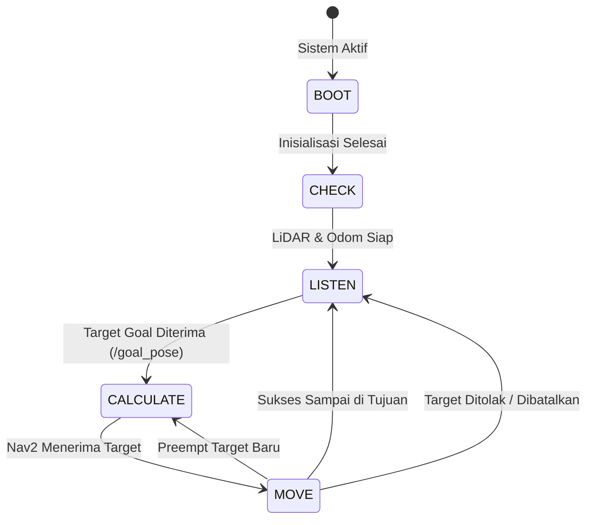

# Node: fsm_node

Paket: `robot_base`  
Executable: `fsm_node`  
File Kode: [`fsm_node.py`](file:///home/acelz/Workspace/nonameRobot/nonameRobotNodes/src/robot_base/robot_base/fsm_node.py)  
Peluncur: [`base.launch.py`](file:///home/acelz/Workspace/nonameRobot/nonameRobotNodes/src/robot_bringup/launch/base.launch.py)

---

## 1. Ringkasan & Peran
`fsm_node` adalah pengelola alur misi tingkat tinggi (*High-Level Mission State Machine*) untuk robot rumah sakit. Node ini bertugas:
1. Memastikan seluruh subsistem perangkat keras (LiDAR dan Odometri) telah aktif dan mengirim data valid sebelum robot menerima misi navigasi (*Health Check*).
2. Menerima target tujuan (`/goal_pose`) dari pengguna (RViz2, dashboard web, atau modul suara).
3. Mengirimkan aksi navigasi (`NavigateToPose`) ke Nav2 Behavior Tree Navigator secara asynchronous.
4. Menangani kondisi khusus seperti pembatalan target (*preemption* saat target baru datang di tengah jalan) dan pelaporan status robot (sampai di tujuan / gagal).

---

## 2. Diagram State Machine (FSM)

- **BOOT**: Inisialisasi subscriber, action client, dan variabel internal.
- **CHECK**: Menunggu penerimaan data pertama dari topik `/scan` dan `/odom`.
- **LISTEN**: Robot siaga di tempat menunggu instruksi ruangan tujuan baru.
- **CALCULATE**: Mengirimkan tujuan via Action Client `navigate_to_pose`.
- **MOVE**: Robot dalam proses pergerakan otonom menuju ruangan tujuan.

---

## 3. Antarmuka Topik & Action

### Subscriptions (Masukan)
| Topik | Tipe Pesan | Deskripsi |
| :--- | :--- | :--- |
| `/scan` | `sensor_msgs/msg/LaserScan` | Verifikasi kesiapan data sensor LiDAR. |
| `/odom` | `nav_msgs/msg/Odometry` | Verifikasi kesiapan data odometri roda. |
| `/goal_pose` | `geometry_msgs/msg/PoseStamped` | Titik koordinat target tujuan yang dikirim pengguna / modul suara. |

### Action Client (Antarmuka Aksi)
| Action Server | Tipe Aksi | Deskripsi |
| :--- | :--- | :--- |
| `navigate_to_pose` | `nav2_msgs/action/NavigateToPose` | Mengirim target navigasi ke BT Navigator Nav2 dan memantau status penyelesaiannya (`SUCCEEDED`, `ABORTED`, `CANCELED`). |

---

## 4. Parameter Konfigurasi
| Parameter | Tipe | Nilai Default | Keterangan |
| :--- | :---: | :---: | :--- |
| `bypass_health_check` | Boolean | `False` | Jika `True`, melewati tahap verifikasi sensor (berguna saat pengujian simulasi murni tanpa hardware fisik). |
