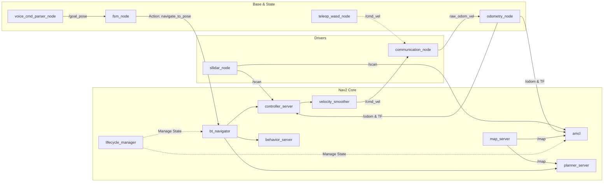

# Dokumentasi Node ROS 2 & Nav2 (Hospital Robot)

Direktori ini mendokumentasikan setiap node yang beroperasi pada sistem robot rumah sakit **nonameRobot**, baik node kustom (*in-house custom nodes*) maupun node bawaan (*Nav2 & ROS 2 built-in nodes*).

---

## 1. Node Kustom In-House (Custom Developed Nodes)

Node-node ini dibangun secara spesifik untuk menjembatani komunikasi ke mikrokontroler, mengintegrasikan sensor, mengelola alur misi (*state machine*), dan interaksi suara.

| No | Nama Node | Paket | Bahasa | File Dokumentasi | Peran Utama |
| :---: | :--- | :--- | :---: | :--- | :--- |
| 1 | `communication_node` | `robot_base` | Python | [`COMMUNICATION_NODE.md`](file:///home/acelz/Workspace/nonameRobot/nonameRobotNodes/nav2_nodes_doc/COMMUNICATION_NODE.md) | Jembatan serial USB biner ke Arduino Mega (low-level). |
| 2 | `odometry_node` | `robot_base` | Python | [`ODOMETRY_NODE.md`](file:///home/acelz/Workspace/nonameRobot/nonameRobotNodes/nav2_nodes_doc/ODOMETRY_NODE.md) | Integrator odometri Runge-Kutta 2nd-order & TF broadcaster `odom -> base_link`. |
| 3 | `fsm_node` | `robot_base` | Python | [`FSM_NODE.md`](file:///home/acelz/Workspace/nonameRobot/nonameRobotNodes/nav2_nodes_doc/FSM_NODE.md) | Finite State Machine pengelola kesiapan hardware & navigasi rumah sakit. |
| 4 | `teleop_wasd_node` | `robot_base` | Python | [`TELEOP_WASD_NODE.md`](file:///home/acelz/Workspace/nonameRobot/nonameRobotNodes/nav2_nodes_doc/TELEOP_WASD_NODE.md) | Kendali manual keyboard WASD darurat / komisioning. |
| 5 | `voice_cmd_parser_node` | `robot_voice_nav` | Python | [`VOICE_CMD_PARSER_NODE.md`](file:///home/acelz/Workspace/nonameRobot/nonameRobotNodes/nav2_nodes_doc/VOICE_CMD_PARSER_NODE.md) | TCP Socket Server (port 5000) penerima perintah suara NLU menuju waypoint kamar/ruangan. |
| 6 | `sllidar_node` | `sllidar_ros2` | C++ | [`SLLIDAR_NODE.md`](file:///home/acelz/Workspace/nonameRobot/nonameRobotNodes/nav2_nodes_doc/SLLIDAR_NODE.md) | Driver perangkat keras laser 2D RPLiDAR. |

---

## 2. Node Bawaan Nav2 Stack (Nav2 Standard Server Nodes)

Node-node ini disediakan oleh framework Nav2 (`nav2_bringup`, `nav2_controller`, `nav2_planner`, dll.) dan dikonfigurasikan melalui file [`nav2_params_paper.yaml`](file:///home/acelz/Workspace/nonameRobot/nonameRobotNodes/src/robot_bringup/config/nav2_params_paper.yaml).

| No | Nama Node | Paket Asal Nav2 | File Dokumentasi | Peran Utama |
| :---: | :--- | :--- | :--- | :--- |
| 1 | `amcl` | `nav2_amcl` | [`AMCL_NODE.md`](file:///home/acelz/Workspace/nonameRobot/nonameRobotNodes/nav2_nodes_doc/AMCL_NODE.md) | Lokalisasi probabilistik robot terhadap peta statis (`map`). |
| 2 | `controller_server` | `nav2_controller` | [`CONTROLLER_SERVER_NODE.md`](file:///home/acelz/Workspace/nonameRobot/nonameRobotNodes/nav2_nodes_doc/CONTROLLER_SERVER_NODE.md) | Eksekutor pelacakan lintasan menggunakan plugin Regulated Pure Pursuit (`FollowPath`). |
| 3 | `planner_server` | `nav2_planner` | [`PLANNER_SERVER_NODE.md`](file:///home/acelz/Workspace/nonameRobot/nonameRobotNodes/nav2_nodes_doc/PLANNER_SERVER_NODE.md) | Perencana rute global terpendek dari posisi robot ke tujuan (Dijkstra/Navfn). |
| 4 | `behavior_server` | `nav2_behaviors` | [`BEHAVIOR_SERVER_NODE.md`](file:///home/acelz/Workspace/nonameRobot/nonameRobotNodes/nav2_nodes_doc/BEHAVIOR_SERVER_NODE.md) | Eksekutor perilaku pemulihan otomatis (*spin, backup, wait*). |
| 5 | `bt_navigator` | `nav2_bt_navigator` | [`BT_NAVIGATOR_NODE.md`](file:///home/acelz/Workspace/nonameRobot/nonameRobotNodes/nav2_nodes_doc/BT_NAVIGATOR_NODE.md) | Orkestrator pohon perilaku (*Behavior Tree*) navigasi. |
| 6 | `map_server` | `nav2_map_server` | [`MAP_SERVER_NODE.md`](file:///home/acelz/Workspace/nonameRobot/nonameRobotNodes/nav2_nodes_doc/MAP_SERVER_NODE.md) | Penyedia peta 2D Occupancy Grid denah rumah sakit ke topik `/map`. |
| 7 | `velocity_smoother` | `nav2_velocity_smoother` | [`VELOCITY_SMOOTHER_NODE.md`](file:///home/acelz/Workspace/nonameRobot/nonameRobotNodes/nav2_nodes_doc/VELOCITY_SMOOTHER_NODE.md) | Penghalus akselerasi dan pembatas kecepatan aman sebelum dikirim ke hardware. |
| 8 | `lifecycle_manager` | `nav2_lifecycle_manager` | [`LIFECYCLE_MANAGER_NODE.md`](file:///home/acelz/Workspace/nonameRobot/nonameRobotNodes/nav2_nodes_doc/LIFECYCLE_MANAGER_NODE.md) | Pengelola transisi siklus hidup (*configure, activate, deactivate*) seluruh node Nav2. |

---

## Diagram Hubungan Node-Node Sistem

