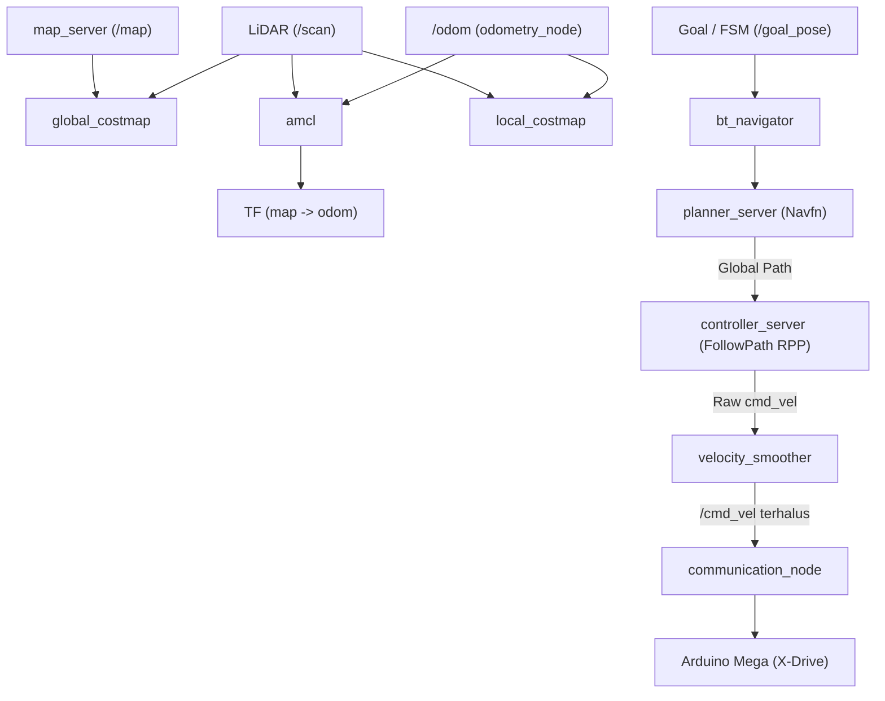

# Dokumentasi Konfigurasi Nav2 Stack (Hospital Robot)

Direktori ini berisi dokumentasi mendalam untuk setiap parameter yang digunakan pada file konfigurasi:  
**[`nav2_params_paper.yaml`](file:///home/acelz/Workspace/nonameRobot/nonameRobotNodes/src/robot_bringup/config/nav2_params_paper.yaml)**.

Konfigurasi ini diturunkan dan disesuaikan berdasarkan eksperimen **Tabel 1 Paper arXiv:2601.15006**, yang dioptimalkan khusus untuk:
1. **Navigasi Tenang & Stabil di Lingkungan Rumah Sakit**: Gerakan anti-zigzag, pengereman halus (*soft-braking*), kurvatur adaptif, dan penghindaran halangan manusia/pasien.
2. **Efisiensi Komputasi SBC (Raspberry Pi 4B)**: Penyesuaian frekuensi controller (10 Hz), planner (1.0 Hz), AMCL particle limits (500–1500), dan costmap updates untuk mencegah CPU *throttling*.

---

## Indeks File Parameter (Berdasarkan Parent Nodes)

| No | Modul / Parent Node | File Dokumentasi | Deskripsi Singkat |
| :---: | :--- | :--- | :--- |
| 1 | **AMCL** | [`AMCL.md`](file:///home/acelz/Workspace/nonameRobot/nonameRobotNodes/nav2_params_doc/AMCL.md) | Lokalisasi probabilistik berbasis partikel filter dengan model gerak omni holonomik. |
| 2 | **Behavior Server** | [`BEHAVIOR_SERVER.md`](file:///home/acelz/Workspace/nonameRobot/nonameRobotNodes/nav2_params_doc/BEHAVIOR_SERVER.md) | Perilaku pemulihan otomatis (*spin, backup, wait*) saat robot mengalami kebuntuan. |
| 3 | **BT Navigator** | [`BT_NAVIGATOR.md`](file:///home/acelz/Workspace/nonameRobot/nonameRobotNodes/nav2_params_doc/BT_NAVIGATOR.md) | Orkestrator Behavior Tree untuk koordinasi planner, controller, dan recovery. |
| 4 | **Controller Server** | [`CONTROLLER_SERVER.md`](file:///home/acelz/Workspace/nonameRobot/nonameRobotNodes/nav2_params_doc/CONTROLLER_SERVER.md) | Pengatur frekuensi pelacakan lintasan, toleransi tujuan, dan pengecekan kemajuan gerak. |
| 5 | **FollowPath Plugin** | [`FOLLOWPATH.md`](file:///home/acelz/Workspace/nonameRobot/nonameRobotNodes/nav2_params_doc/FOLLOWPATH.md) | Algoritma Regulated Pure Pursuit (RPP) dengan reduksi kecepatan kurvatur dan kedekatan objek. |
| 6 | **Local Costmap** | [`LOCAL_COSTMAP.md`](file:///home/acelz/Workspace/nonameRobot/nonameRobotNodes/nav2_params_doc/LOCAL_COSTMAP.md) | Peta rintangan lokal bergerak ($3\text{m} \times 3\text{m}$) untuk pencegahan benturan real-time. |
| 7 | **Global Costmap** | [`GLOBAL_COSTMAP.md`](file:///home/acelz/Workspace/nonameRobot/nonameRobotNodes/nav2_params_doc/GLOBAL_COSTMAP.md) | Peta rintangan global denah rumah sakit untuk perencanaan rute antar-ruangan. |
| 8 | **Map Server** | [`MAP_SERVER.md`](file:///home/acelz/Workspace/nonameRobot/nonameRobotNodes/nav2_params_doc/MAP_SERVER.md) | Pemuat file peta statis 2D Occupancy Grid (`.yaml` & `.pgm`). |
| 9 | **Planner Server** | [`PLANNER_SERVER.md`](file:///home/acelz/Workspace/nonameRobot/nonameRobotNodes/nav2_params_doc/PLANNER_SERVER.md) | Perencana rute global terpendek berbasis ekspansi Dijkstra (Navfn). |
| 10 | **Velocity Smoother** | [`VELOCITY_SMOOTHER.md`](file:///home/acelz/Workspace/nonameRobot/nonameRobotNodes/nav2_params_doc/VELOCITY_SMOOTHER.md) | Pembatas akselerasi, deselerasi, dan kecepatan batas linier/rotasi pada output `/cmd_vel`. |

---

## Ringkasan Arsitektur Data Nav2

