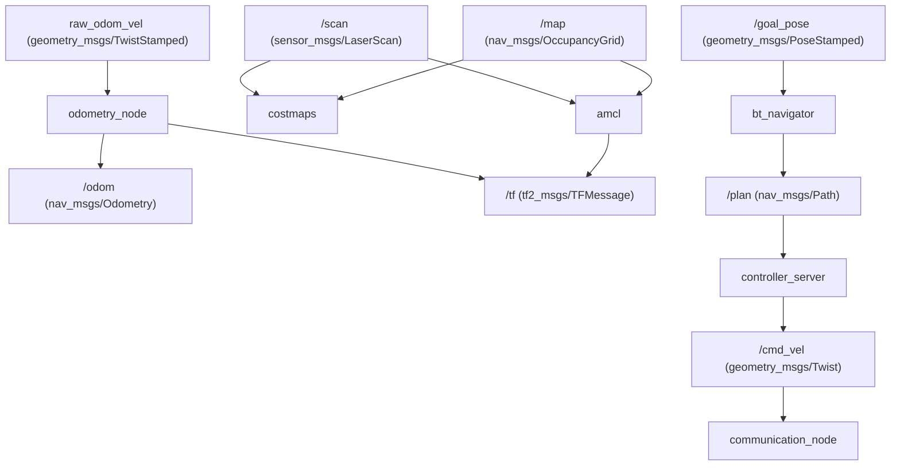

# Dokumentasi Topik ROS 2 & Nav2 (Hospital Robot)

Direktori ini mendokumentasikan setiap topik komunikasi yang aktif pada proyek robot rumah sakit **nonameRobot**. Setiap dokumen memuat tipe pesan, publisher, subscriber, frekuensi publikasi, profil QoS (*Quality of Service*), serta perannya dalam siklus operasi robot.

---

## Tabel Master Seluruh Topik Sistem

| No | Nama Topik | Tipe Pesan | Node Penerbit (Publisher) | Node Penerima (Subscriber) | Frekuensi | File Dokumentasi |
| :---: | :--- | :--- | :--- | :--- | :---: | :--- |
| 1 | `/cmd_vel` | `geometry_msgs/msg/Twist` | `velocity_smoother` / `teleop_wasd` | `communication_node` | $10\text{–}20\text{ Hz}$ | [`CMD_VEL.md`](file:///home/acelz/Workspace/nonameRobot/nonameRobotNodes/nav2_topics_doc/CMD_VEL.md) |
| 2 | `raw_odom_vel` | `geometry_msgs/msg/TwistStamped` | `communication_node` | `odometry_node` | $20\text{ Hz}$ | [`RAW_ODOM_VEL.md`](file:///home/acelz/Workspace/nonameRobot/nav2_topics_doc/RAW_ODOM_VEL.md) |
| 3 | `/odom` | `nav_msgs/msg/Odometry` | `odometry_node` | `amcl`, `controller_server`, `fsm_node` | $20\text{–}50\text{ Hz}$ | [`ODOM.md`](file:///home/acelz/Workspace/nonameRobot/nonameRobotNodes/nav2_topics_doc/ODOM.md) |
| 4 | `/scan` | `sensor_msgs/msg/LaserScan` | `sllidar_node` | `amcl`, `costmaps`, `fsm_node` | $10\text{–}12\text{ Hz}$ | [`SCAN.md`](file:///home/acelz/Workspace/nonameRobot/nonameRobotNodes/nav2_topics_doc/SCAN.md) |
| 5 | `/tf` & `/tf_static` | `tf2_msgs/msg/TFMessage` | `odometry_node`, `amcl`, `static_tf` | Seluruh Node Nav2 & RViz2 | $50\text{ Hz}$ | [`TF_AND_TF_STATIC.md`](file:///home/acelz/Workspace/nonameRobot/nonameRobotNodes/nav2_topics_doc/TF_AND_TF_STATIC.md) |
| 6 | `/map` | `nav_msgs/msg/OccupancyGrid` | `map_server` | `amcl`, `global_costmap`, RViz2 | Transient | [`MAP.md`](file:///home/acelz/Workspace/nonameRobot/nonameRobotNodes/nav2_topics_doc/MAP.md) |
| 7 | `/goal_pose` | `geometry_msgs/msg/PoseStamped` | `voice_cmd_parser_node`, RViz2 | `fsm_node`, `bt_navigator` | Asinkron | [`GOAL_POSE.md`](file:///home/acelz/Workspace/nonameRobot/nonameRobotNodes/nav2_topics_doc/GOAL_POSE.md) |
| 8 | `/initialpose` | `geometry_msgs/msg/PoseWithCovarianceStamped` | Operator RViz2 / Dashboard | `amcl` | Asinkron | [`INITIAL_POSE.md`](file:///home/acelz/Workspace/nonameRobot/nonameRobotNodes/nav2_topics_doc/INITIAL_POSE.md) |
| 9 | `/amcl_pose` & `/particlecloud` | `PoseWithCovarianceStamped` / `ParticleCloud` | `amcl` | RViz2, FSM | $2\text{–}5\text{ Hz}$ | [`AMCL_POSE.md`](file:///home/acelz/Workspace/nonameRobot/nonameRobotNodes/nav2_topics_doc/AMCL_POSE.md) |
| 10 | `/plan` | `nav_msgs/msg/Path` | `planner_server` | `controller_server`, RViz2 | $1.0\text{ Hz}$ | [`PLAN_TOPICS.md`](file:///home/acelz/Workspace/nonameRobot/nonameRobotNodes/nav2_topics_doc/PLAN_TOPICS.md) |
| 11 | Costmap Grids & Footprints | `nav2_msgs/Costmap` & `PolygonStamped` | `local_costmap`, `global_costmap` | `controller_server`, RViz2 | $1.0\text{–}4.0\text{ Hz}$ | [`COSTMAP_TOPICS.md`](file:///home/acelz/Workspace/nonameRobot/nonameRobotNodes/nav2_topics_doc/COSTMAP_TOPICS.md) |
| 12 | Nav2 Action Topics | `nav2_msgs/action/*` | `bt_navigator`, `fsm_node` | Servers (Planner, Controller, Behaviors) | Aksi Misi | [`ACTION_TOPICS.md`](file:///home/acelz/Workspace/nonameRobot/nonameRobotNodes/nav2_topics_doc/ACTION_TOPICS.md) |

---

## Diagram Aliran Data Topik

