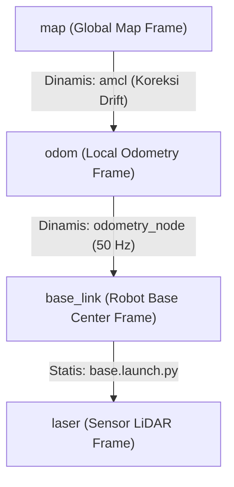

# Topik: /tf dan /tf_static

Tipe Pesan: `tf2_msgs/msg/TFMessage`  
Penerbit (Publishers):  
- `/tf`: `odometry_node` (odom $\rightarrow$ base_link), `amcl` (map $\rightarrow$ odom)  
- `/tf_static`: `link_base_laser` (base_link $\rightarrow$ laser)  
Penerima (Subscribers): Seluruh node Nav2, RViz2, Costmaps, TF Buffer Listener  
Frekuensi:  
- `/tf`: $20\text{–}50\text{ Hz}$  
- `/tf_static`: Dipublikasikan sekali saat start (QoS Transient Local, Durability Latched)  

---

## 1. Deskripsi & Peran
Sistem koordinat transformasi (TF2) menghubungkan seluruh kerangka acuan spasial pada robot. Setiap data sensor atau perintah navigasi dikonversikan antar-frame melalui topik ini.

---

## 2. Struktur Pohon Koordinat (TF Tree)



### Relasi dan Transformasi:
1. **`map` $\rightarrow$ `odom`** (Dinamis oleh `amcl`): Mengompensasi akumulasi *wheel slip* atau *drift* odometri terhadap peta absolut rumah sakit.
2. **`odom` $\rightarrow$ `base_link`** (Dinamis oleh `odometry_node`): Mengalirkan posisi instan robot relatif terhadap titik start.
3. **`base_link` $\rightarrow$ `laser`** (Statis oleh `static_transform_publisher`): Offset sensor LiDAR fisik di sasis:
   $$X = -0.10\text{ m}, \quad Y = 0.0\text{ m}, \quad Z = 0.20\text{ m}, \quad \text{Yaw} = \pi\text{ rad } (180^\circ)$$

---

## 3. Struktur Pesan (`tf2_msgs/msg/TFMessage`)
```yaml
geometry_msgs/TransformStamped[] transforms:
  std_msgs/Header header:
    builtin_interfaces/Time stamp
    string frame_id          # Frame induk (parent)
  string child_frame_id      # Frame anak (child)
  geometry_msgs/Transform transform:
    geometry_msgs/Vector3 translation  # x, y, z
    geometry_msgs/Quaternion rotation  # x, y, z, w
```
